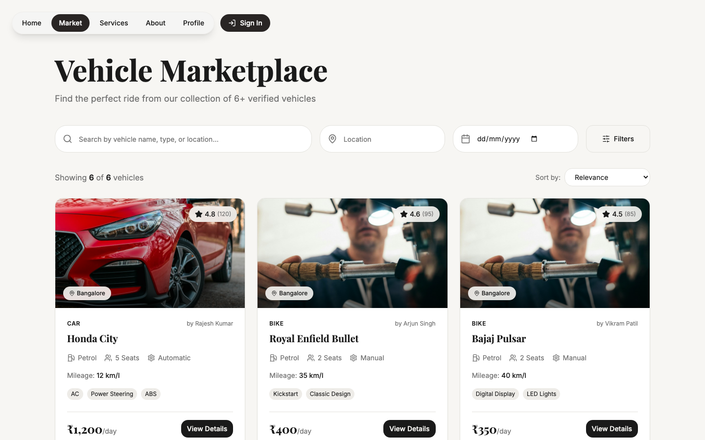
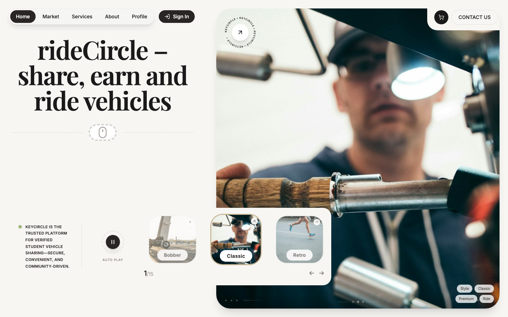

# KeyCircle

A vehicle-sharing marketplace prototype with a React frontend, a vehicle marketplace route and an API workspace. The interface explores how people could list, discover and request vehicles for short rentals.

## Product flows

- Browse sample vehicles with search, location, date and filter controls.
- Open a vehicle detail view and review its specifications.
- Explore share and rent flows.
- View profile and dashboard screens.
- Inspect the sign-in and sign-up interface.

## Tech

- Frontend: React, TypeScript, Vite, Tailwind CSS, React Router and Lucide.
- API workspace: TypeScript/Express modules for users, vehicles and bookings.
- Data integration: Supabase configuration and SQL migration files are included.

## Run the frontend

~~~sh
cd frontend
npm ci
npm run dev
~~~

Open the Vite URL printed in the terminal. The frontend is the easiest way to explore the current UI.

## Prototype status

Vehicle cards and credentials in the frontend are demo data. Authentication currently uses a local demo flow, not production-grade account security. The API and database workspaces require their own configuration and integration before they can support real users, bookings, identity checks or payments. Do not use the demo login or verification screens for real customer data.

## Author

Built by [Om Rashiya](https://github.com/rashiyaom).
